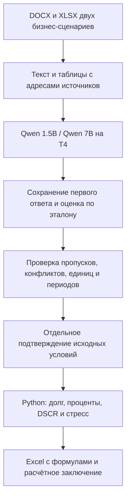

# AI-анализ проектов малого и среднего бизнеса

Дополнительный материал к заявке: два синтетических бизнес-сценария, сравнение двух языковых моделей на Kaggle и воспроизводимые расчёты финансирования.

## Что посмотреть

1. **[Исследование на двух T4](benchmarks/report.md)** — результаты Qwen 1.5B и 7B, ошибки и ограничения.
2. **Малый бизнес — пекарня:** [заключение](benchmarks/examples/small/decision.md), [Excel](benchmarks/examples/small/model.xlsx), [исходные документы](benchmarks/cases/small/complete/source/).
3. **Средний бизнес — мебельное производство:** [заключение](benchmarks/examples/medium/decision.md), [Excel](benchmarks/examples/medium/model.xlsx), [исходные документы](benchmarks/cases/medium/complete/source/).

Все данные вымышлены. Названия «малый» и «средний» обозначают масштаб сценариев, а не подтверждённую юридическую категорию МСП. Ставки и ограничения придуманы для демонстрации, не являются методикой банка.

## Два расчётных примера

| Показатель, млн ₽ | Пекарня | Мебельное производство |
|---|---:|---:|
| Бюджет проекта | 8,00 | 120,00 |
| Собственное участие | 3,00 | 45,00 |
| Потребность в кредите | 5,00 | 75,00 |
| Предел при базовом CFADS | 4,39 | 74,07 |
| Предел в стрессовом сценарии | 3,29 | 59,26 |
| Непокрытая потребность | **1,71** | **15,74** |

Срок — пять лет, погашение основного долга равными годовыми долями. Пекарня: ставка 18%, снижение CFADS в стрессе на 25%. Производство: ставка 16%, снижение на 20%. Условный порог DSCR — 1,2 в каждом году обоих сценариев. Дефицит требует дополнительных средств или пересмотра условий; результат не является одобрением кредита.

## Что именно проверили на GPU

Для каждого бизнеса подготовлены три варианта: полные согласованные данные, конфликт бюджета между Word и Excel, пропуск собственного участия. Получилось шесть комплектов документов.

На двух Tesla T4 выполнены **12 запусков**: Qwen2.5-1.5B-Instruct и Qwen2.5-7B-Instruct, по одному первому ответу на каждый комплект. Обе модели использовали один пайплайн Transformers, одинаковое 4-битное NF4-квантование и FP16-вычисления. Промпты не подбирались по ответам, обучение не проводилось.

У 7B совпали **64 из 66 значений с единицами и периодами**. При этом строгая проверка адресов дала 0/78 из-за нарушенного формата, а к четырём найденным проблемам добавились 18 ложных сигналов. У 1.5B все шесть ответов не прошли прямой JSON-разбор. Это разные аспекты качества, поэтому 64/66 нельзя выдавать за общую точность сервиса.

На GPU передавались только исходные тексты и промпты. Эталоны остались локально. Сохраняются [все сырые ответы и метаданные](benchmarks/results/raw/), [машинная оценка](benchmarks/results/summary.json), [протокол](docs/benchmark-protocol.md), [эталоны и манифест](benchmarks/cases/).

Поле засчитывается при правильных значении, единице и периоде одновременно. Отдельно проверяются адреса источников и обнаружение проблем. Поэтому прочитать правильное число недостаточно: оно должно быть пригодно для последующего расчёта.

## Как устроена демонстрация



Финансовые примеры строятся по условиям из confirmed.json, подтверждённым автором синтетических сценариев. Ответ модели напрямую в расчёт не подставляется. В конфликтных и неполных документах требуется уточнение; это не автоматическое сквозное одобрение сделки.

## Воспроизведение без GPU и сети

Python 3.11 или новее, команды из корня репозитория:

```bash
python3 -m venv .venv
source .venv/bin/activate
python -m pip install -r requirements.txt
python -m unittest discover -s tests -v
python scripts/summarize_gpu_benchmark.py
```

Последняя команда заново оценивает сохранённые ответы и создаёт отчёт исследования, JSON с метриками и два финансовых комплекта. Загружать модели не требуется. Excel содержит формулы и пересчитывается при открытии; числа Python доступны в JSON и Markdown.

Проверка формул в настоящем табличном движке:

```bash
FINANCE_SOFFICE=/path/to/soffice python -m unittest tests.test_excel_engine -v
```

Для нового GPU-запуска используйте [worker](scripts/run_gpu_benchmark.py); аргументы доступны через `--help`. Точные версии библиотек, revisions моделей и настройки сохранены в environment.json каждого запуска. Ссылки и токены доступа к Kaggle в репозиторий не включены.

## Формула расчёта

CFADS — денежный поток для обслуживания долга; в примере он задан автором напрямую. DSCR = CFADS / (погашение основного долга + проценты).

Для долга `D`, срока `n`, ставки `r` и года `t` от 0 до `n−1` платёж равен `D × [1/n + r × (1−t/n)]`. Предел долга за год: `CFADS[t] / {DSCR_min × [1/n + r × (1−t/n)]}`. Предел сценария — минимум за все годы; при неположительном CFADS положительный долг не допускается. Сумма для рассмотрения ограничивается потребностью и пределами обоих сценариев.

## Границы результата

Два синтетических случая не доказывают качество на реальных банковских документах. Производные варианты одного бизнеса зависимы. Экономия рабочего времени и прогноз кредитного риска не измерялись; 95% точности и 30% экономии остаются целями будущего пилота.

В примере нет полноценного сервиса, RAG, кредитного скоринга, сублимитов, обеспечения и полной прогнозной отчётности. Другие шаблоны потребуют адаптации парсера. Для сроков сверх пяти лет нужно дополнить источники и проверить их подписи. Изменения внутри Excel не обновляют JSON и Markdown — согласованный комплект создаётся скриптом.

[Предварительный опыт с маленькой моделью в Ollama](output/research.md) сохранён отдельно вместе с [исходным кейсом](case/). Его результаты не смешиваются с новым сравнением на GPU.

Код: [генерация кейсов](src/benchmark.py), [оценка](src/gpu_benchmark.py), [расчёт](src/finance.py), [экспорт](src/report.py).
