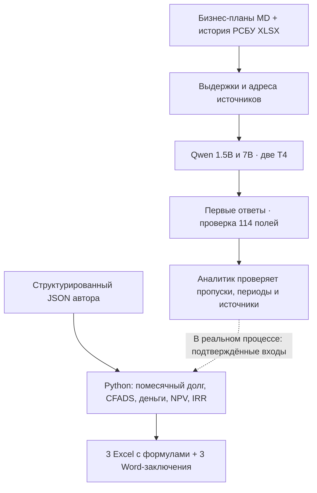

# AI-анализ инвестиционных проектов

Три промышленных бизнес-плана из предоставленного синтетического набора: **гофроупаковка, модернизация металлообработки и сушка пиломатериалов**. Для каждого подготовлены Excel с формулами и Word-заключение. На двух Tesla T4 проверено извлечение финансовых данных моделями Qwen 1.5B и 7B.

## Начать здесь

- **[Скачать 3 Excel и 3 Word одним архивом](studies/industrial-v2/deliverables.zip)**.
- **[Исследование: результаты, ошибки и методика](studies/industrial-v2/REPORT.md)**.
- [Исходные документы пользователя](studies/industrial-v2/input/) · [оригинальный ZIP](studies/industrial-v2/source-archive.zip).
- [Все первые ответы моделей](studies/industrial-v2/results/raw/) · [машинная оценка](studies/industrial-v2/results/summary.json) · [протокол до запуска](studies/industrial-v2/PROTOCOL.md).

| Проект | Бюджет / кредит, млн ₽ | Мин. DSCR в годы погашения | NPV при 22%, млн ₽ | Готовые файлы |
|---|---:|---:|---:|---|
| Гофроупаковка | 107,60 / 65,00 | 1,188 | −5,84 | [Excel](studies/industrial-v2/outputs/01_Гофроупаковка/financial-model.xlsx) · [Word](studies/industrial-v2/outputs/01_Гофроупаковка/conclusion.docx) |
| Металлообработка | 65,90 / 36,00 | 2,737 | 24,32 | [Excel](studies/industrial-v2/outputs/02_Модернизация_металлообработки/financial-model.xlsx) · [Word](studies/industrial-v2/outputs/02_Модернизация_металлообработки/conclusion.docx) |
| Сушка пиломатериалов | 107,40 / 55,00 | 1,454 | −9,56 | [Excel](studies/industrial-v2/outputs/03_Сушка_пиломатериалов/financial-model.xlsx) · [Word](studies/industrial-v2/outputs/03_Сушка_пиломатериалов/conclusion.docx) |

DSCR в таблице исключает годы без погашения основного долга. У сушки первый год имеет отрицательный CFADS и DSCR, несмотря на положительный денежный остаток. У металлообработки DSCR относится ко всему участку, NPV — к приростному потоку. Подробности и ограничения раскрыты в заключениях.

## Что показал GPU-тест

| Модель | Верные значение, единица и период | Также верный адрес источника | Ошибка JSON-разбора |
|---|---:|---:|---:|
| Qwen2.5-1.5B-Instruct | 0/114 | 0/114 | 6 из 6 ответов |
| Qwen2.5-7B-Instruct | 82/114 | 76/114 | 0 из 6 ответов |

Это строгая оценка первых неизменённых ответов на шести задачах для каждой модели. У 7B пропущены 30 прогнозных полей и два нулевых значения заменены на null; ещё шесть чисел имеют неверные ссылки. У 1.5B непригоден формат JSON. На этих данных автоматическое заполнение финансовой модели без проверки аналитиком ненадёжно. Обучение и подбор промптов по результатам не проводились; общая точность на реальном потоке заявок не установлена.

## Архитектура примера



Финансовые файлы этой демонстрации рассчитаны по структурированному JSON автора, а не по неполному ответу модели. Независимо проверена арифметика, но операционные прогнозы не подтверждались. Сценарии автора сохранены с отдельной пометкой. Ориентир DSCR 1,20 и механический стресс EBITDA −20% служат демонстрации, не являются нормативами банка. Действующий долг компаний раскрыт отдельно от нового проекта. Все компании вымышлены; результат — предварительная техническая проверка, не кредитное решение.

## Воспроизвести без GPU

```bash
python -m pip install -r requirements.txt
python scripts/summarize_industrial_study.py
python scripts/build_industrial_outputs.py
python -m unittest discover -s tests -v
python scripts/verify_industrial_excel.py --soffice /path/to/soffice
```

Опубликованные Excel уже пересчитаны LibreOffice: проверено 3 492 числовые ячейки. После генерации из Python формулы можно пересчитать в Excel/LibreOffice. Для повторного GPU-запуска сохранены ревизии моделей, промпты, параметры и хеши; подробности в [исследовании](studies/industrial-v2/REPORT.md) и [инструкции восстановления](RESTORE.md).

## Предыдущие материалы

[Два ранних примера малого и среднего бизнеса](docs/previous-demo.md) и [первое парное исследование](benchmarks/report.md) сохранены как архив. Их метрики относятся к другим данным и не объединяются с текущим исследованием.
