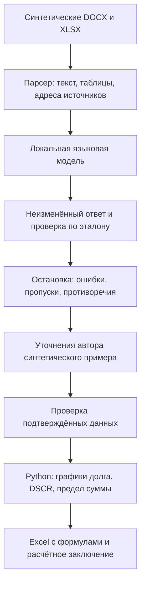

# AI и проектное финансирование

**Технический пример к заявке:** разбор документов инвестиционного проекта, проверка данных и воспроизводимый расчёт суммы долга по заданному денежному потоку.

Проект вымышленный. Ставка, денежные потоки и ограничения заданы для демонстрации и не являются методикой Т-Банка или другого банка. Окончательное кредитное решение здесь не принимается.

## Посмотреть за три минуты

1. **[Исследование](output/research.md)** — фактический запуск небольшой локальной модели, ошибки и выводы.
2. **[Расчётное заключение](output/decision.md)** — потребность, предел долга, дефицит и вопросы для проверки.
3. **[Excel с формулами](output/model.xlsx)** — исходные условия, два графика долга, DSCR и результат. Для просмотра скачайте файл и откройте в Excel или LibreOffice.

Исходные документы: [описание проекта DOCX](case/source/project.docx) и [финансовые данные XLSX](case/source/financials.xlsx). Их текст с адресами источников доступен [без скачивания Office-файлов](case/model-input.txt).

## Что показывает пример

В Word бюджет составляет **100 млн ₽**, а в Excel — **110000 тыс. ₽**, то есть 110 млн ₽. Собственное участие отсутствует. Эти проблемы должны останавливать расчёт и возвращаться на уточнение.

В [отдельном файле уточнений](case/confirmed.json) автор синтетического примера выбрал бюджет 100 млн ₽ и добавил собственное участие 40 млн ₽. Это новые условия примера, а не сведения, успешно извлечённые AI. После уточнения код рассчитывает:

| Показатель | млн ₽ |
|---|---:|
| Потребность в кредите | 60,00 |
| Предел при базовом CFADS | 57,14 |
| Предел при снижении CFADS на 20% | 45,71 |
| Сумма для рассмотрения в рамках примера | 45,71 |
| Непокрытая потребность | **14,29** |

Дефицит сохраняется: для продолжения нужны дополнительные средства или изменение условий. Выполнение ограничения DSCR само по себе не доказывает кредитоспособность.

## Архитектура демонстрации



Исходный ответ AI не поступает в финансовый расчёт автоматически. Код и уточнения проверяются отдельно. В целевом сервисе подтверждение выполнял бы специалист банка; в демонстрации его заменяют явно записанные условия автора.

## Фактический эксперимент с AI

Один запуск `qwen2.5:1.5b` через локальную Ollama, без обучения, подбора промпта по результату и повторных попыток. Эталон создан до запуска и не передавался модели.

- **1 из 11 полей** соответствует полному контракту «значение + единица + период»; конфликт бюджета дополнительно требует сохранения обеих версий.
- **4 из 12 ожидаемых пар поле–источник** имеют правильный адрес. Метрика проверяет адреса отдельно и не доказывает корректность значения.
- **0 из 2 ожидаемых сигналов** доступны в предусмотренном верхнеуровневом `issues`: модель поместила список внутрь `fields` и не оформила конфликт бюджета корректно.

Это результат одного случая и одной маленькой модели, а не оценка точности всех LLM. В части полей числовые значения верны, но единицы, периоды или структура нарушены. [Подробный разбор](output/research.md) объясняет строгость метрики и ограничения.

Доступны [промпт](case/prompt.md), [полный запрос](case/model-request.json), [сырой ответ](case/model-response.txt), [метаданные модели](case/model-metadata.json), [эталон](case/gold.json) и [машинная оценка](output/extraction-evaluation.json). Финансовый расчёт воспроизводится без модели и сети.

## Как воспроизвести

Python 3.11 или новее. Команды выполняются из корня репозитория.

```bash
python3 -m venv .venv
source .venv/bin/activate
python -m pip install -r requirements.txt
python -m unittest discover -s tests -v
python scripts/run_case.py --input case/confirmed.json --output output
```

Появятся `output/calculation.json`, `output/model.xlsx` и `output/decision.md`. Excel содержит формулы и пересчитывается при открытии. Числовые результаты Python доступны в JSON и Markdown без табличного приложения.

Чтобы изменить сценарий, отредактируйте `case/confirmed.json`. При изменении бюджета или собственного участия обновите соответствующее подтверждение в `resolutions`; иначе расчёт остановится. Срок задаёт число строк графиков: меняйте его вместе с CFADS в JSON и запускайте генерацию заново. Изменения внутри Excel не обновляют JSON, Markdown и исходный SHA256 — для согласованного комплекта используйте скрипт.

Необязательные проверки формул в настоящем табличном движке:

```bash
FINANCE_SOFFICE=/path/to/soffice python -m unittest tests.test_excel_engine -v
```

Повторный запуск модели требует установленной [Ollama](https://ollama.com/) и загрузки примерно 1 ГБ весов. Он перезапишет сохранённые артефакты эксперимента; для нового исследования используйте копию репозитория.

```bash
ollama pull qwen2.5:1.5b
python scripts/run_extraction.py
```

Синтетические документы можно восстановить командой `python -m src.fixtures`. Пакеты зафиксированы в `requirements.txt`; настройки, digest модели и полный запрос сохранены. Побайтовое совпадение Office-файлов и нового ответа модели между версиями окружения не гарантируется.

## Формулы и границы

CFADS — денежный поток, доступный для обслуживания долга; он задан непосредственно, а не выведен из полной отчётности. DSCR равен CFADS / (погашение основного долга + проценты). Основной долг погашается равными годовыми долями; проценты начисляются на остаток начала года.

Для долга `D`, срока `n`, ставки `r` и года `t` от 0 до `n−1` платёж равен `D × [1/n + r × (1−t/n)]`. Годовой предел долга: `CFADS[t] / {DSCR_min × [1/n + r × (1−t/n)]}`. Предел сценария — минимум за все годы; при неположительном CFADS положительный долг не допускается. Итоговая сумма ограничивается потребностью и пределами обоих сценариев.

Пример не включает полноценный сервис, RAG, кредитный скоринг, сублимиты, обеспечение, прогнозные ОФР/ОДДС/баланс и обучение регрессионных моделей. Экономия рабочего времени, прогноз кредитного риска и качество на реальных банковских документах не измерялись. Цели 30% экономии времени и 95% точности из заявки остаются гипотезами будущего пилота.

Код расчёта: [finance.py](src/finance.py). Проверки и оценка извлечения: [extraction.py](src/extraction.py). Экспорт: [report.py](src/report.py). [План реализации](docs/superpowers/plans/2026-11-15-financing-case.md).
